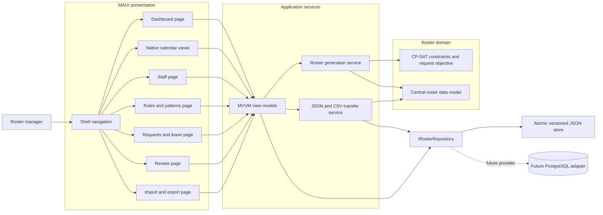
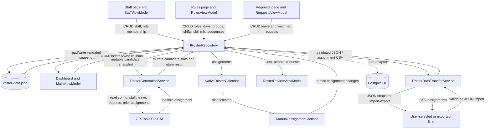
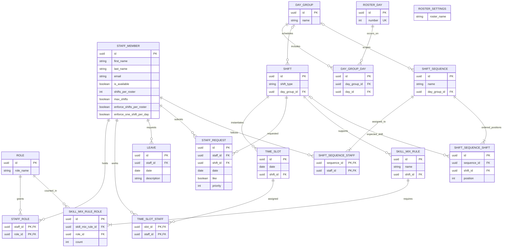
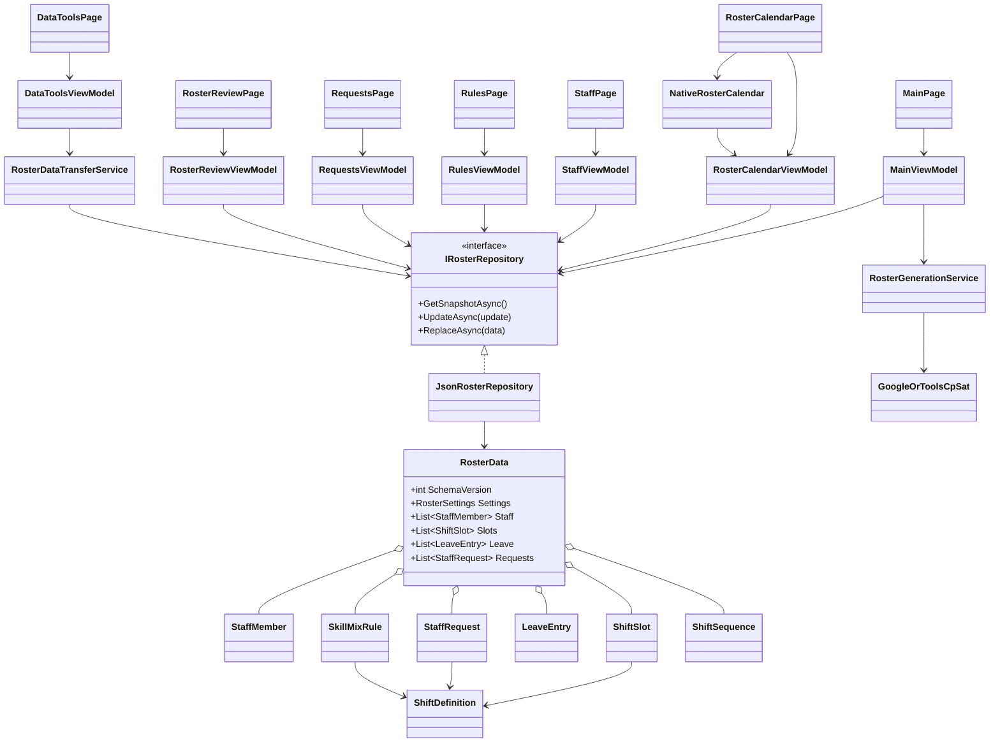

<div align="center">
    

# KronOS | Agentic Roster Wizard

_An agentic AI roster management system for different team modes: native on Windows, iOS and Android._

[](#)


 


</div>


`KronOS | ShiftSync` is a desktop-first, native .NET MAUI roster manager for nursing teams, event ambassadors, session supervisors, and custom scheduling flows. This repository contains the C# port of the roster-wizard workflow: configure staff, roles, repeating day groups, shifts, exact skill-mix requirements, shift sequences, leave and weighted staff requests; generate, manually edit, review and export a roster.

The port was reverse engineered from the Django/OR-Tools `roster-wizard` source and FullCalendar 6.1.11 examples supplied alongside this repository. The roster calendar is implemented as native MAUI controls in C#, not as a hosted HTML/JavaScript FullCalendar widget. Its native views reproduce the relevant FullCalendar month/day-grid, week/day time-grid, list-week, previous/next/today, date navigation and event editing workflows.

> The original application uses OR-Tools CP-SAT, Celery and a Django REST API. This native application runs its CP-SAT solver in-process and persists its central roster data locally as JSON. It does not currently connect to a Django service, remote API, or PostgreSQL server.

<div align="center">
~✦~

[](https://www.figma.com/design/r6HypyaMg0J0RnK7gomaWd/Flow?node-id=130-158&t=5KOGRBjGbwZ4PEN6-1)
[]()
[](https://github.com/arzenikos/shift-sync-agentic/wiki/Local-Installation-Guide) <br/>

</div>

## Tech stack

| Area | Technology |
| --- | --- |
| Desktop/mobile UI | .NET MAUI, C# 14 / .NET 10 |
| Presentation | MVVM with CommunityToolkit.Mvvm observable properties and relay commands |
| Navigation | MAUI Shell |
| Calendar | Native MAUI `Grid`, `CollectionView`, `ScrollView`, date navigation, and C# calendar-view control |
| Roster optimization | Google OR-Tools CP-SAT (`Google.OrTools` 9.12.4544) |
| Local central store | Versioned JSON snapshot in the MAUI application data directory; serialized updates and atomic file replacement |
| Import/export | Portable JSON snapshot and roster-assignment CSV |
| Core verification | MSTest tests for solver staffing/leave/request behavior and data integrity |
| Future database integration | Explicit foreign-key-like GUID references in the central data model; no PostgreSQL provider is configured yet |

## Windows desktop launch

### Prerequisites

- Windows 10 version 17763 or later (Windows 10/11 recommended).
- .NET 10 SDK and the **.NET MAUI development** workload in Visual Studio 2022/2026, or the matching MAUI workload installed for the .NET SDK.
- Windows App SDK / Windows MAUI build prerequisites installed by the MAUI workload.

From PowerShell, at the repository root:

```powershell
dotnet workload restore .\RosterWizard\Kronos.RosterWizard.csproj
dotnet restore .\RosterWizard\Kronos.RosterWizard.csproj
dotnet build .\RosterWizard\Kronos.RosterWizard.csproj -f net10.0-windows10.0.19041.0
dotnet run --project .\RosterWizard\Kronos.RosterWizard.csproj -f net10.0-windows10.0.19041.0
```

Run the focused solver and data-validation tests with:

```powershell
dotnet test .\RosterWizard.Tests\RosterWizard.Tests.csproj
```

The Windows target is configured as an unpackaged desktop application (`WindowsPackageType=None`). In Visual Studio, open `RosterWizard\Kronos.RosterWizard.csproj`, choose the Windows Machine target, and press **F5**.

For a Release build:

```powershell
dotnet publish .\RosterWizard\Kronos.RosterWizard.csproj -f net10.0-windows10.0.19041.0 -c Release
```

## Current feature coverage

- **Dashboard:** shows counts for staff, roles, shift types, slots and assignments; choose the first date to generate a roster.
- **Roster calendar:** native month, week, day and list-week views; navigate backward/forward or return to today; select a calendar date to open day view.
- **Manual roster edit:** select a slot to add/remove staff or clear the assignments. This deliberately follows the source application's behavior: a manual edit is persisted as entered and is not automatically re-solved or validated against every rule. Regenerate to re-apply constraints.
- **Staff:** add, edit and remove staff, assign multiple roles, set availability, set contracted shifts per roster and configure target rounding, target enforcement and one-shift-per-day enforcement.
- **Roster patterns:** set roster period length (day records), create day groups, select the recurring roster day numbers for each group, and create shift types.
- **Skill mix:** create one or more rule alternatives for a shift and set exact required counts per role. The solver chooses one rule for each generated slot.
- **Shift sequences:** create ordered staff shift/off patterns and append or remove sequence positions. Repeating a complete configured sequence is forbidden, including patterns that overlap from the previous roster period.
- **Leave:** add or remove staff leave by date and description. Leave is a hard exclusion in roster generation.
- **Staff requests:** record liked/disliked staff/shift/date combinations with priority. They are weighted in the solver objective; they are preferences, not guarantees.
- **Roster review:** inspect assignments grouped by staff and compare each request with its generated/manual assignment.
- **Data tools:** export all roster configuration and operational records as JSON, import a validated JSON backup, or export assignments as CSV.
- **Starter dataset:** on first run, a sample 14-day roster template, day/evening/night shift types, two roles, one exact two-role skill-mix rule per shift, seven staff and several requests are seeded locally to demonstrate generation. Replace or edit these example records before real operational use.

### Solver behavior and source compatibility

The CP-SAT implementation enforces staff availability, leave, optional one-shift-per-day limits, leave-adjusted target shift counts with configurable rounding, the source solver's first-half target constraint, exact skill-mix role counts and shift-sequence exclusions. It maximizes the sum of liked request priorities minus disliked request priorities and uses a 120-second solve limit. Infeasible or timed-out-without-a-feasible-solution generation reports an error instead of publishing a success-shaped roster.

The source's explicit `Day` records determine period length. A `Shift` belongs to an optional `DayGroup`; group/day links derive the date/shift slots. A shift with no skill-mix rules may have any staffing count, just as the source model permits. The source implementation calculates a shift-rule staffing minimum but applies the largest rule total as both minimum and maximum; this port uses each selected rule's exact role counts and does not silently invent that separate total-staff constraint.

### Local data and PostgreSQL readiness

All entities are held in one `RosterData` aggregate and persisted at:

```text
<MAUI AppDataDirectory>\roster-data.json
```

On Windows this is inside the current user's local app data for the package/app identity. Exports are written to an `Exports` subdirectory beneath the MAUI app-data directory. JSON includes `schemaVersion`; imports are checked for supported schema, unique identifiers, valid references, consecutive roster-day numbers, and unique date/shift slots and relationship memberships before replacing the existing dataset. The repository serializes updates, persists a temporary snapshot, then atomically replaces the data file.

`Domain\Models.cs` defines entity records with GUID identifiers and explicit relation IDs so data can be mapped to PostgreSQL primary keys, foreign keys and association tables without depending on MAUI or the current file-store implementation. PostgreSQL is a future persistence adapter, not an active connection or required server dependency.

## Architecture at a glance



## Component data flow



## ERD



`SHIFT_SEQUENCE_SHIFT.shift_id` is nullable to represent an explicit off/blank position. The source Django API exposes leave and timeslot endpoints plus roster generation, but does not expose the rule/configuration entities; the new app's repository is its single application data boundary.

## Class diagram



## Sequence: generate and view a roster

```mermaid
sequenceDiagram
    actor Manager
    participant Dashboard as Dashboard/MainViewModel
    participant Generator as RosterGenerationService
    participant Repository as IRosterRepository
    participant Solver as OR-Tools CP-SAT
    participant Store as JSON store
    participant Calendar as NativeRosterCalendar
    Manager->>Dashboard: Choose start date and generate
    Dashboard->>Repository: UpdateAsync(candidate => Generate(candidate, date))
    Repository->>Store: Load snapshot
    Store-->>Repository: Roster configuration and existing assignments
    Repository->>Generator: Invoke update callback with isolated candidate snapshot
    Generator->>Solver: Build hard constraints and weighted request objective
    Solver-->>Generator: Feasible/optimal assignment or status
    alt Feasible solution found
        Generator->>Generator: Create slots and assigned staff in candidate
        Generator-->>Repository: Return generation result from callback
        Repository->>Store: Validate, write temp snapshot, replace data file
        Store-->>Repository: Persisted
        Repository-->>Dashboard: Generation result and request score
        Manager->>Calendar: Open roster calendar
        Calendar->>Repository: GetSnapshotAsync
        Repository->>Store: Read current snapshot
        Store-->>Calendar: Assignments, shifts and staff
        Calendar-->>Manager: Render month/week/day/list view
    else No feasible assignment
        Solver-->>Generator: Infeasible or no feasible solution
        Generator-->>Repository: Propagate generation error from callback
        Repository-->>Dashboard: Generation failed; candidate is not persisted
        Dashboard->>Dashboard: Log failure and keep prior snapshot unchanged
        Dashboard-->>Manager: Show failure status
    end
```

## Sequence: import/export and future external calls

```mermaid
sequenceDiagram
    actor Manager
    participant Page as DataToolsPage
    participant Transfer as RosterDataTransferService
    participant Picker as MAUI file picker
    participant Repository as IRosterRepository
    participant Store as Local JSON store
    participant Postgres as Future PostgreSQL adapter
    Manager->>Page: Export JSON or CSV
    Page->>Transfer: Export request
    Transfer->>Repository: GetSnapshotAsync
    Repository->>Store: Read roster-data.json
    Store-->>Transfer: Central roster snapshot
    Transfer-->>Page: Serialized JSON or CSV
    Page-->>Manager: Write export into app Exports folder
    Manager->>Page: Import JSON snapshot
    Page->>Picker: Pick JSON file
    Picker-->>Page: Selected file
    Page->>Transfer: ImportJsonAsync(stream)
    Transfer->>Transfer: Deserialize and validate schema/references
    Transfer->>Repository: ReplaceAsync(validated snapshot)
    Repository->>Store: Atomically replace local JSON
    Store-->>Manager: Import complete
    Note over Repository,Postgres: PostgreSQL calls are not implemented; add another IRosterRepository adapter and explicit sync/migration policy when the database is introduced.
```

## Important source-compatibility notes

- The source app's target shift count is adjusted by the fraction of roster dates not covered by leave; `max_shifts` chooses ceiling versus floor. When target enforcement is on, its solver also requires exactly `floor(adjustedTarget / 2)` assignments in the first half of the available dates.
- Requests are a soft objective weighted by priority (`like` adds weight; dislike subtracts it), not hard constraints.
- Skill-mix role counts are exact for the selected shift rule.
- Manual edits in the original web app clear/rebuild assignments without re-running the solver. The MAUI edit UI likewise does not claim edits are automatically rule-validated.
- The source generator has a likely bug in its separate total staffing constraint: it computes a minimum but uses the maximum as both bounds. The port avoids encoding that apparent mistake; exact role counts from a selected rule determine its staffing.
- The original web application's accounts, permissions, Django REST token authentication, Celery task queue, and remote service APIs are not reproduced. This is a local-first desktop app rather than an authenticated multi-user server deployment.

## Project layout

```text
kronos/
├─ RosterWizard/
|  ├─ Application/Services/           CP-SAT generation and import/export services
|  |  ├─ Domain/                      Central entities, schema validation
|  |  ├─ Infrastructure/              Repository interface and atomic JSON persistence
|  |  └─ Presentation/
|  |     ├─ Controls/                 Native C# calendar renderer
|  |     ├─ Pages/                    Dashboard, calendar, staff, rules, requests, review, data tools
|  |     └─ ViewModels/               MVVM state and commands
└─ RosterWizard.Tests/
    ├─ RosterGenerationTests.cs       CP-SAT and roster-data integrity tests
    └─ RosterGeneration.Tests.csproj
```

---

Created by Arsenie — 2026