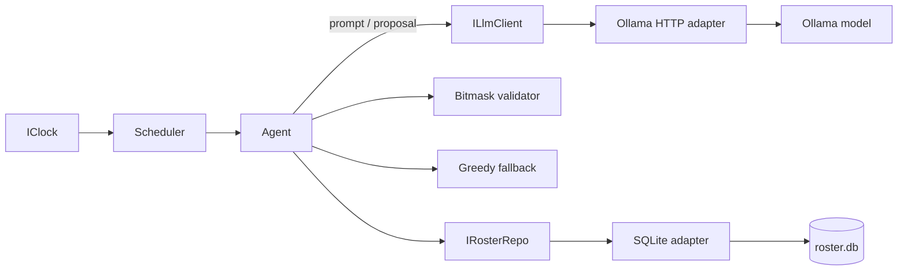

<div align="center">
  

# KronOS | Ward Roster Lab

[](https://isocpp.org/)
[](https://sqlite.org/)
[](https://ollama.com/)
[](https://www.docker.com/)

</div>

KronOS is a local-first ward roster agent. On a schedule, a local Ollama model proposes one day of shifts; a small deterministic C++ core checks it, retries with rule violations, and falls back to a greedy plan if needed. The validated days and a run record are appended to SQLite.

> **The LLM proposes, deterministic C++ decides.**

## 2. Architecture at a glance



The scheduler runs one tick at a time. The agent plans the next date window day by day: ask the LLM, validate the proposal, send violations on a retry (up to three proposals per day), then use the deterministic fallback if necessary. Only the repository adapter writes the validated window.

## 3. Features and design decisions

- **Hexagonal boundaries:** the core talks to `ILlmClient`, `IRosterRepo`, and `IClock`; Ollama and SQLite can be replaced without moving I/O into the validator.
- **Fast, auditable validation:** each of at most 64 staff members maps to one `uint64_t` bit. `std::popcount`, RN and SeniorRN masks, and overlap checks validate a day without allocations. Violation text is formatted only when a retry prompt is built.
- **Explicit failures:** `std::expected` is used when available; the vcpkg `tl::expected` header is the compatibility fallback. Invalid config, malformed replies, timeouts, and database failures stay errors rather than becoming valid-looking plans.
- **Safe fallback:** a deterministic, rotating greedy plan covers the capacity and skill rules when all three proposals fail.
- **Local-first and cost-free:** no cloud API, key, paid service, or application telemetry. The app talks only to local Ollama and a local SQLite file. vcpkg metrics are disabled in Docker/CI and can be disabled for native builds.
- **Scheduling and persistence:** standard-library calendar dates, a `std::jthread`/stop-token scheduler, a transaction per saved run, WAL mode, and idempotent first-run staff seeding.

## 4. Prerequisites and dependencies

### Runtime

| Name | Purpose | Licence | Installation |
|---|---|---|---|
| Roster Lab C++ app | Scheduling, validation, persistence | This repository's licence | Build from source or Docker |
| SQLite 3 | Local roster database | Public domain | Included through vcpkg for native builds; Ubuntu runtime package in Docker |
| Ollama | Local model HTTP server | MIT | Install Ollama locally or use the Compose service |
| `llama3.2:3b` (default) | Local proposal model | Meta Llama 3.2 Community License (not OSI open source; review Meta's terms) | `ollama pull llama3.2:3b` |

### Build tools

| Name | Purpose | Licence | Installation |
|---|---|---|---|
| C++ compiler (GCC 13+ or Clang 17+; MSVC 2022 17.6+) | C++20 build (`std::expected` when the library supports it) | GCC: GPL-3.0-or-later with runtime exception; LLVM: Apache-2.0 WITH LLVM-exception; MSVC: Microsoft terms | Install a compiler and, on Windows, the C++ SDK/toolset |
| CMake 3.25+ | Configure and build | BSD-3-Clause | [cmake.org](https://cmake.org/download/) |
| Ninja | Preset generator | Apache-2.0 | Install Ninja from your OS package manager |
| vcpkg | Manifest-mode dependency manager | MIT | `git clone https://github.com/microsoft/vcpkg.git` then run its bootstrap script |
| Docker Engine + Compose plugin (optional) | Build and run the packaged demo | Apache-2.0 / Apache-2.0 | Install Docker Desktop or Docker Engine with Compose |


### C++ libraries

| Name | Purpose | Licence | Installation |
|---|---|---|---|
| cpr | Ollama HTTP client | MIT | vcpkg manifest |
| nlohmann/json | JSON schema/request and defensive response parsing | MIT | vcpkg manifest |
| SQLite C API | SQLite adapter | Public domain | vcpkg manifest |
| spdlog | Structured console logging | MIT | vcpkg manifest |
| CLI11 | Command-line options | BSD-3-Clause | vcpkg manifest |
| toml++ | TOML config parsing | MIT | vcpkg manifest |
| tl::expected | C++20 fallback for expected values | CC0-1.0 | vcpkg manifest |
| GoogleTest | Unit and adapter tests | BSD-3-Clause | vcpkg manifest |
| RapidCheck | Property-based greedy test | BSD-2-Clause | vcpkg manifest |
| Google Benchmark | Validator and fallback microbenchmarks | Apache-2.0 | vcpkg manifest |


The default model is free to download and runs locally, but its license is not an OSI-approved open-source license. The software libraries above are free/open-source; model terms are a separate consideration.

## 5. Setup and run

### (a) Docker quick start

The Compose file was validated with `docker compose config`. The image and services were **not run** because Docker Desktop's Linux engine was unavailable.

```sh
docker compose up -d ollama
docker compose exec ollama ollama pull llama3.2:3b
docker compose up --build -d agent
docker compose logs -f agent
```

For another model, set `OLLAMA_MODEL` before starting Compose; the same value configures Ollama requests. The app's SQLite file is bind-mounted at `./data/roster.db`. On Linux, create `data/` and allow container UID 10001 to write to it before the first run.

### (b) Native CMake build

The verified build ran natively in WSL Ubuntu 24.04 with GCC 13.3, CMake, Ninja, and vcpkg. A Windows-native build was **not tested** because this machine has no Visual Studio C++ toolset. For WSL/Linux, install the prerequisites, set `VCPKG_ROOT` to your vcpkg clone, then run:

```sh
export VCPKG_ROOT="$HOME/vcpkg"
export VCPKG_DISABLE_METRICS=1
cmake --preset debug
cmake --build --preset debug
ctest --preset debug
```

For a Windows-native build, install the compiler listed above and set up vcpkg in PowerShell:

```powershell
git clone https://github.com/microsoft/vcpkg.git "$HOME\vcpkg"
& "$HOME\vcpkg\bootstrap-vcpkg.bat" -disableMetrics
$env:VCPKG_ROOT = "$HOME\vcpkg"
$env:VCPKG_DISABLE_METRICS = "1"
cmake --preset debug
cmake --build --preset debug
ctest --preset debug
```

The vcpkg bootstrap and WSL/Linux debug build and tests were run here; the Windows-native build commands are **untested**. For an optimized build, substitute `release` for `debug`. CMake presets use Ninja and manifest-mode vcpkg.

### (c) Pulling the model

The Compose service uses a named `ollama` volume, so downloaded weights persist. Pull the default model once before starting the agent:

```sh
ollama pull llama3.2:3b
```

This command was **not run here** because no Ollama service was available. For native runs, start Ollama locally and pull the same model.

### (d) Two-minute demo and inspecting results

The default config runs immediately on startup, then waits two minutes between completed ticks. The demo plans three days per run. Later ticks begin on the day after the previous run's `WindowEnd`; assignments are appended rather than regenerated.

Inspect the database on the host with `sqlite3` (or open `data/roster.db` in DB Browser for SQLite):

```sql
SELECT Id, RanAt, WindowStart, WindowEnd, Attempts, UsedFallback
FROM Runs ORDER BY Id;

SELECT Date,
       CASE Slot WHEN 0 THEN 'AM' WHEN 1 THEN 'PM' WHEN 2 THEN 'Night' END AS Shift,
       COUNT(*) AS StaffCount
FROM Assignments
GROUP BY Date, Slot
ORDER BY Date, Slot;

SELECT a.Date,
       CASE a.Slot WHEN 0 THEN 'AM' WHEN 1 THEN 'PM' WHEN 2 THEN 'Night' END AS Shift,
       s.Id, s.Name, s.Skill
FROM Assignments AS a
JOIN Staff AS s ON s.Id = a.StaffId
ORDER BY a.Date, a.Slot, s.Id;
```

## 6. Configuration reference

The root `config.toml` is used by default. Each setting can be overridden with the matching environment variable.

| Key | Environment variable | Demo default | Meaning |
|---|---|---:|---|
| `ConnectionStrings.Db` | `ConnectionStrings__Db` | `data/roster.db` | SQLite file path |
| `Ollama.Url` | `Ollama__Url` | `http://localhost:11434` | Local Ollama base URL |
| `Ollama.Model` | `Ollama__Model` | `llama3.2:3b` | Model name |
| `Ollama.Temperature` | `Ollama__Temperature` | `0.55` | Moderate variation between proposals |
| `Ollama.Seed` | `Ollama__Seed` | `42` | Request seed |
| `Roster.Interval` | `Roster__Interval` | `00:02:00` | Delay between completed runs |
| `Roster.WindowDays` | `Roster__WindowDays` | `3` | Number of days planned per run |

**Demo vs. real cadence:** demo = 2-minute interval / 3-day window; real-use example = 14-day interval / 14-day window. These are sample settings, not a production-ready staffing policy.

## 7. Testing, sanitizers and benchmarks

The test suite includes validator rule cases, a RapidCheck property for greedy rosters, window rollover, config parsing, a fake-LLM retry/fallback flow, response-parser edge cases, in-memory SQLite persistence, and a scheduler no-overlap/stop test. No test requires Ollama.

```sh
cmake --preset debug
cmake --build --preset debug
ctest --preset debug
cmake --preset asan
cmake --build --preset asan
ctest --preset asan
cmake --preset ubsan
cmake --build --preset ubsan
ctest --preset ubsan
cmake --preset tsan
cmake --build --preset tsan
setarch x86_64 -R ctest --test-dir build/tsan -R Scheduler --output-on-failure
```

The debug, release, ASan, and UBSan builds and tests passed under WSL Ubuntu 24.04 / GCC 13.3. The TSan scheduler test also passed; this WSL host required `setarch x86_64 -R` to avoid ThreadSanitizer's `unexpected memory mapping` startup failure. The presets and GitHub Actions workflow also configure GCC/Clang release and ASan builds. `clang-tidy` was not run because its executable was unavailable in WSL.

The parser fuzz target requires Clang/libFuzzer:

```sh
cmake -S . -B build/fuzz -DROSTER_ENABLE_FUZZING=ON -DCMAKE_TOOLCHAIN_FILE="$VCPKG_ROOT/scripts/buildsystems/vcpkg.cmake"
cmake --build build/fuzz --target roster-parser-fuzz
./build/fuzz/roster-parser-fuzz -max_len=4096
```

The Google Benchmark executable measures `validate()` and `greedy()`:

```sh
./build/release/roster-bench --benchmark_repetitions=5 --benchmark_format=json
```

Measured over five repetitions with Google Benchmark 1.10.0, GCC 13.3, Release/LTO, under WSL Ubuntu 24.04 on the 12-vCPU host reported as 2.611 GHz:

| Benchmark | Mean CPU time ± standard deviation |
|---|---:|
| `BM_Validate` | 0.498 ± 0.120 ns/day |
| `BM_Greedy` | 1.558 ± 0.400 us/day |

The run showed substantial variability, especially for this sub-nanosecond validator in a virtualized environment; these numbers are indicative, not a cross-machine performance claim. Rerun on the intended deployment hardware before comparing or publishing results.

## 8. Project structure

```text
.
├── src/
│   ├── core/                      # Types, validator, greedy, agent loop
│   ├── ports/                     # LLM, repository, clock interfaces
│   ├── adapters/                  # Ollama HTTP and SQLite
│   └── app/                       # Config, scheduler, main
├── tests/
├── bench/
├── fuzz/
├── CMakeLists.txt
├── CMakePresets.json
├── config.toml
├── docker-compose.yaml
├── Dockerfile
└── vcpkg.json
```


## 10. Limitations and roadmap

- Single ward, hardcoded staff and rules; no leave, preferences, availability, or fairness accounting.
- No cross-day rest constraints (for example, Night followed by AM), workload balancing, authentication, UI, or API.
- SQLite is for this local single-process demo; add PostgreSQL behind `IRosterRepo` when multi-user deployment is needed.
- Improve the greedy fallback with a solver-based option and add a roster viewer/API.
- Validate the end-to-end Docker flow and benchmark performance on supported build hosts before using outside a demo.


| First run | Later run |
|---|---|
|  |  |
